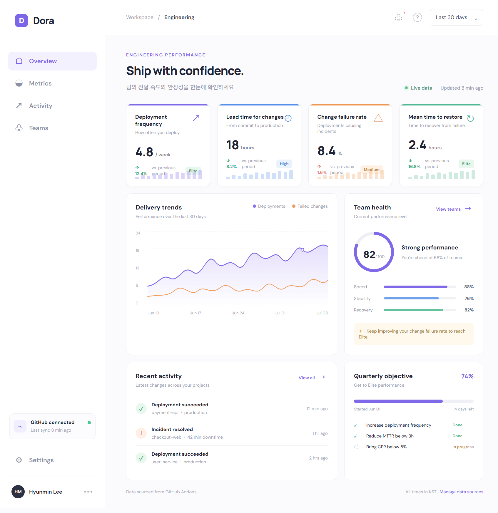

# Dora

## DORA dashboard prototype

`index.html`을 브라우저에서 열면 GitHub Actions 기반 DORA 4대 지표 대시보드 시안을 확인할 수 있습니다.

- Deployment frequency
- Lead time for changes
- Change failure rate
- Mean time to restore (MTTR)

현재 화면은 연결된 데이터 소스가 없는 상태에서도 검토할 수 있도록 샘플 데이터를 사용합니다. 실제 운영 화면으로 연결할 때는 `app.js`의 샘플 데이터와 GitHub API 또는 별도 집계 API를 교체하면 됩니다. 기존 워크플로(`deploy-tracker.yml`, `metrics.yml`, `CFR.yml`, `MTTR.yml`)에서 산출한 이벤트를 기간별로 집계해 각 카드와 추이 차트에 주입하는 구조를 전제로 합니다.